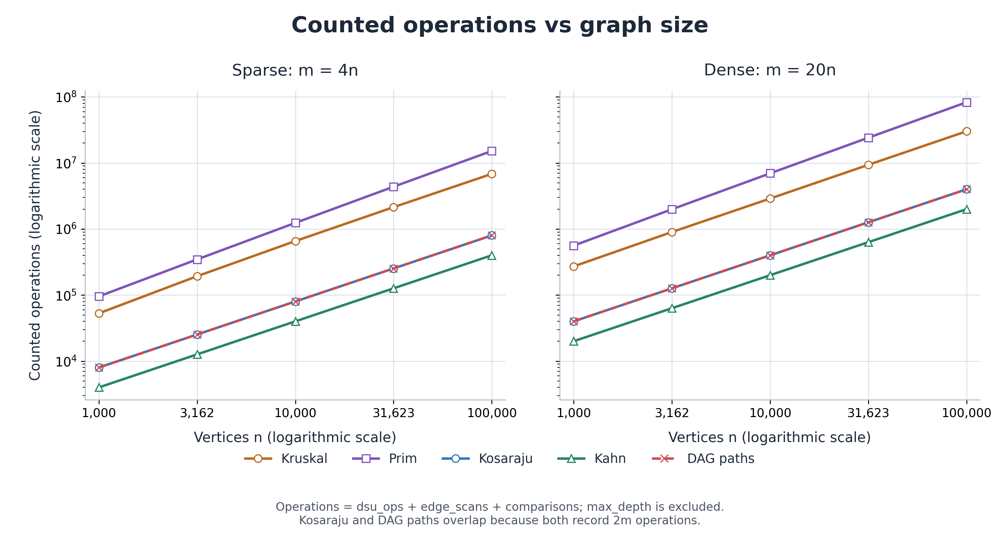
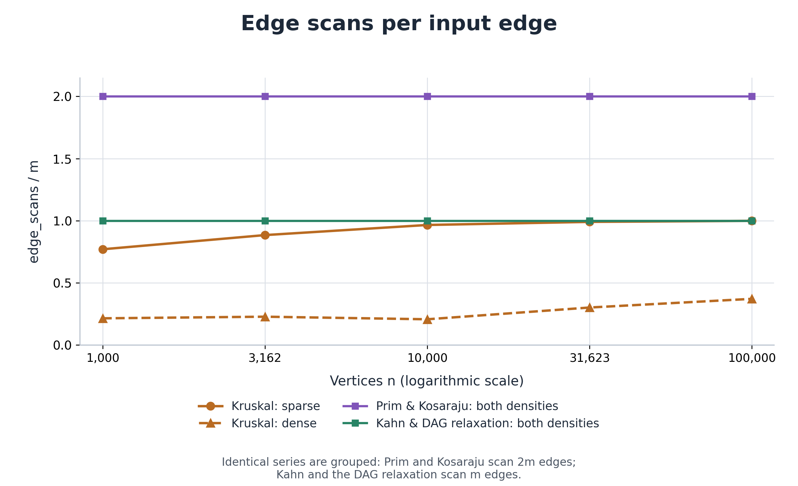
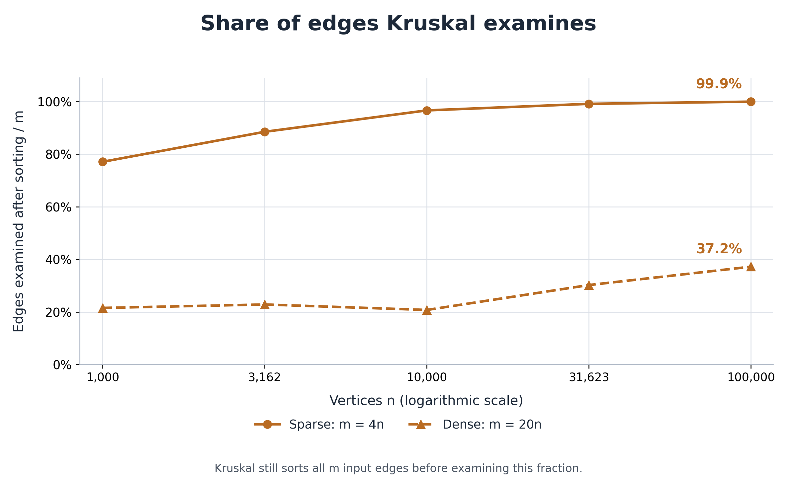

# DAA Assignment 3 Graph Algorithms Report

## 1. Implementation and experiment

The project uses one adjacency-list Graph class for directed and undirected weighted graphs. Kruskal and Prim build minimum spanning forests; Kosaraju identifies strongly connected components; Kahn returns a topological order or reports a cycle; DAG relaxation restores shortest paths from all in-degree-zero sources. Vertices are numbered 0 to V-1, edge weights are int, and total weights and distances use long.

Five sizes were tested: 1,000, 3,162, 10,000, 31,623, and 100,000 vertices. Each size uses sparse E=4V and dense E=20V graphs, with separate undirected, directed, and DAG inputs. Every generator starts with a fresh Random(42). There is one untimed warm-up and five timed runs per algorithm and configuration; the CSV stores the median time and one run's counters, which are checked for equality across the five runs. All ten reference cases matched, producing 50 CSV rows; the complete JUnit 5 suite passed 31 tests.

### Complexity table

| Operation | Time | Extra space | Justification |
| --- | --- | --- | --- |
| DSU find / union | O(alpha(V)) amortized | O(1) per call | Union by size limits tree growth; path compression flattens searched paths. The stored DSU arrays use O(V) space. |
| DSU makeSet | O(V) | O(V) | Initializes parent and size arrays for all vertices. |
| Kruskal | O(V + E log(E+1)) | O(V + E) | Initializes DSU, sorts a copy of all edges, then examines edges using DSU. |
| Prim (lazy queue) | O(V + E log(E+1)) | O(V + E) | Scans adjacency lists and uses a queue with up to O(E) pending edges; stale targets are skipped. |
| Kosaraju | O(V + E) | O(V + E) | Two iterative DFS passes and a reversed graph; stacks, component lists, and arrays are bounded by O(V). |
| Kahn | O(V + E) | O(V) | Copies stored in-degrees, queues each vertex once, and scans each directed edge once. |
| DAG shortest paths | O(V + E) | O(V) | Includes topological sorting, then one relaxation pass with distance and parent arrays. |

Lazy Prim can retain O(E) queue entries, so its general multigraph bound uses log(E+1). On simple graphs, log E is O(log V). Restoring a path of L vertices takes O(L) time and space.

## 2. Correctness and algorithm selection

### Cut property

A cut divides the vertices into two groups. The lightest edge connecting those groups is safe to choose when the cut keeps already selected trees intact. If an optimal spanning forest doesn’t contain that edge, we can swap it with another crossing edge without increasing the weight. This is why Kruskal and Prim produce a minimum spanning forest.
### Induction on the topological order - why a single pass of relaxations is enough in a DAG.

In topological order, every predecessor is processed before the vertex itself. Therefore, when we reach a vertex, all possible incoming paths have already been considered, so its shortest distance is final. We then update its neighbors.

Negative weights are allowed because a DAG has no cycles. Recorded parent vertices let us reconstruct the shortest paths.
### Which algorithm when

| Situation | Choice | Reason |
| --- | --- | --- |
| Undirected edge list | Kruskal | Sorting and DSU fit the representation; disconnected inputs naturally return a forest. |
| Undirected adjacency list | Prim | The priority queue grows a component through its frontier; restart at unvisited vertices for a forest. |
| This benchmark's dense road graphs | Kruskal | Its sorting and DSU work use fewer counted operations than this implementation of lazy Prim. |
| Directed graph with possible deadlocks | Kosaraju | Finds SCCs even when cycles exist; a singleton is cyclic only if it has a self-loop. |
| Dependent jobs; cycle status unknown | Kahn | Returns a valid schedule only when all V vertices leave the queue. |
| DAG with signed edge costs | DAG shortest paths | A topological relaxation pass handles negative weights in O(V+E). |

## 3. Counters vs formulas

Let W = dsu_ops + edge_scans + comparisons; max_depth is excluded because it is a maximum, not an additive operation count. The tables use W / (E log2(E)) for the two MST algorithms and W / (V+E) for the traversals. Every table entry is calculated from the recorded counters, separately for each density.

### Sparse graphs

| V | Kruskal | Prim | Kosaraju | Kahn | DAG paths |
| --- | --- | --- | --- | --- | --- |
| 1,000 | 1.1054 | 1.9962 | 1.6000 | 0.8000 | 1.6000 |
| 3,162 | 1.1199 | 2.0121 | 1.6000 | 0.8000 | 1.6000 |
| 10,000 | 1.0751 | 2.0260 | 1.6000 | 0.8000 | 1.6000 |
| 31,623 | 0.9992 | 2.0390 | 1.6000 | 0.8000 | 1.6000 |
| 100,000 | 0.9192 | 2.0419 | 1.6000 | 0.8000 | 1.6000 |

### Dense graphs

| V | Kruskal | Prim | Kosaraju | Kahn | DAG paths |
| --- | --- | --- | --- | --- | --- |
| 1,000 | 0.9514 | 1.9647 | 1.9048 | 0.9524 | 1.9048 |
| 3,162 | 0.8925 | 1.9722 | 1.9048 | 0.9524 | 1.9048 |
| 10,000 | 0.8221 | 1.9793 | 1.9048 | 0.9524 | 1.9048 |
| 31,623 | 0.7696 | 1.9817 | 1.9048 | 0.9524 | 1.9048 |
| 100,000 | 0.7219 | 1.9851 | 1.9048 | 0.9524 | 1.9048 |

Traversal ratios are exactly flat. Prim stays near 2, while Kruskal's normalized ratio declines rather than remaining exactly constant.

The two panels contain one series for every algorithm and density. Kosaraju and DAG paths overlap at W=2E, although their counters describe different work.

## 4. Edge-scan measurements

Prim and Kosaraju have edge_scans/E=2, while Kahn and DAG relaxation have edge_scans/E=1. 

At V=100,000, Kruskal examines 399,668/400,000=99.9% of sparse edges and 743,572/2,000,000=37.2% of dense edges before its forest becomes a tree. It still sorts all input edges first, so an early stop reduces the DSU phase rather than eliminating sorting work.

## 5. Slopes and measured time

| Algorithm | Scan slope sparse | Scan slope dense | W slope sparse | W slope dense |
| --- | --- | --- | --- | --- |
| Kruskal | 1.0550 | 1.1194 | 1.0537 | 1.0219 |
| Prim | 1.0000 | 1.0000 | 1.1007 | 1.0850 |
| Kosaraju | 1.0000 | 1.0000 | 1.0000 | 1.0000 |
| Kahn | 1.0000 | 1.0000 | 1.0000 | 1.0000 |
| DAG paths | 1.0000 | 1.0000 | 1.0000 | 1.0000 |

Slopes are ordinary least-squares fits of log(counter) against log(V), using all five sizes within one density. The traversal scan slopes are 1.0000.

### Median times at V=100,000

| Algorithm | Sparse ms | Dense ms |
| --- | --- | --- |
| Kruskal | 158.824 | 797.643 |
| Prim | 428.600 | 2187.790 |
| Kosaraju | 196.541 | 595.126 |
| Kahn | 42.567 | 90.813 |
| DAG paths | 76.169 | 149.938 |

Kruskal is faster than this lazy Prim implementation on both largest cases, matching its lower counted work. Small timings are not monotone: sparse Kahn takes 2.057 ms at V=1,000 and 0.503 ms at V=3,162. A median of five runs reduces outliers but cannot remove JVM compilation, garbage collection, hardware, or background-load effects.